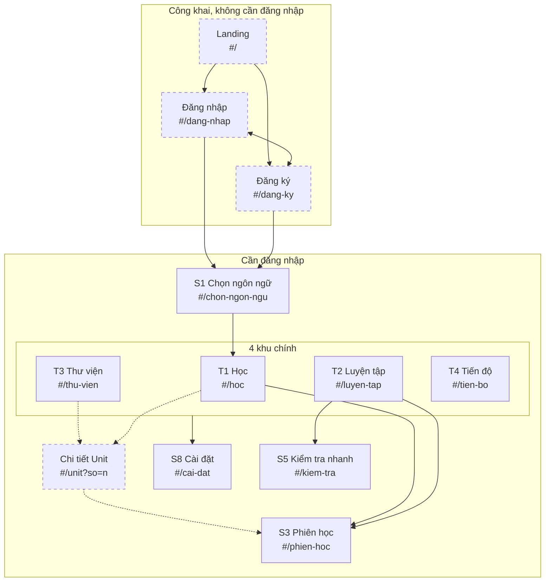
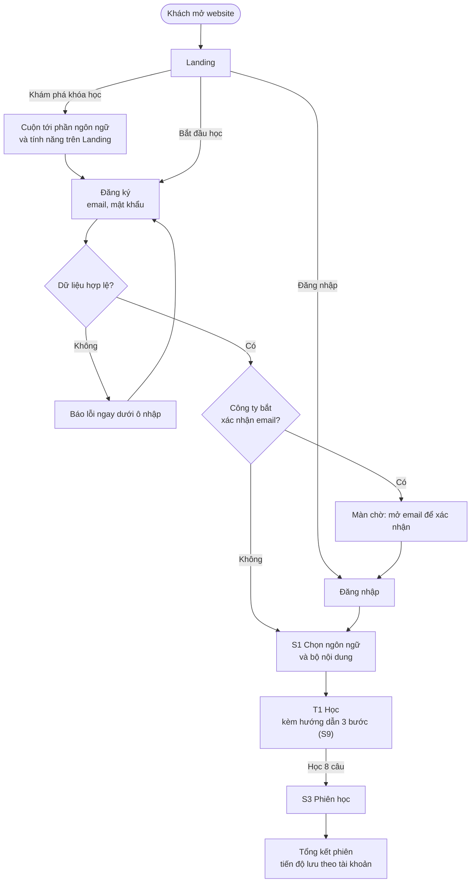
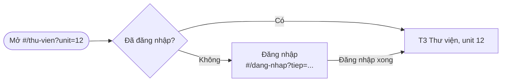

# Mô tả sản phẩm, sitemap và user flow (Đợt 5)

Trạng thái: đề xuất (20/10/2026), dùng để nhóm thống nhất trước khi viết spec cho các màn mới của Đợt 5 (việc 11). Dựa trên QD-06, QD-07 trong `docs/QUYET-DINH.md`.

Các màn mới (Landing, Đăng nhập, Đăng ký, Chi tiết Unit) chưa có mã yêu cầu, nên sơ đồ ở đây chưa đưa vào `navigation.md` (mọi mũi tên ở đó phải gắn `%% @spec`). Khi spec của từng màn có mã, chuyển mũi tên tương ứng sang `navigation.md` và xóa khỏi file này. Khi file này khác spec, spec thắng.

## 1. Mô tả sản phẩm

**Tên:** VITASR Đa ngôn ngữ.

**Mục tiêu:** giúp người Việt nói được câu giao tiếp thông dụng của một ngoại ngữ, bằng các phiên học ngắn mỗi ngày: học 8 câu trong 5 đến 10 phút, nghe câu, tự kiểm tra nhớ hay chưa, và ôn lại câu sắp quên đúng lúc.

**Đối tượng:**

| Nhóm | Nhu cầu | Bộ nội dung phù hợp |
|---|---|---|
| Người đi làm, sinh viên học tiếng Anh giao tiếp | Học lẻ tẻ trong ngày, cần biết mình tiến bộ | Global English (A1 đến C2, có tình huống và cách dùng) |
| Người chuẩn bị du lịch, du học, đi làm ở nước ngoài | Câu dùng ngay được ở sân bay, khách sạn, cửa hàng | English Fluency, hoặc ngôn ngữ của nước sẽ đến |
| Người học ngôn ngữ thứ hai, thứ ba | Một app cho nhiều ngôn ngữ, tiến độ tách riêng từng ngôn ngữ | English Fluency của 15 ngôn ngữ |

Giao diện bằng tiếng Việt, từ người mất gốc đến nâng cao.

**Chức năng chính** (đã có, chi tiết ở spec từng khu):

| Chức năng | Màn | Người học làm gì |
|---|---|---|
| Học theo lộ trình | T1 Học, S3 Phiên học | Mỗi phiên 8 câu: xem và nghe câu, tự đánh giá "Tôi nhớ" hay "Cần ôn lại", rồi làm trắc nghiệm |
| Ôn câu sắp quên | T1, T2 Luyện tập | Câu tự đến hạn ôn sau 1, 3, 7, 14, 30 ngày (DATA-07) |
| Học theo từ khóa | T2 | Gõ "đặt phòng", "sân bay"… để học đúng nhóm câu cần |
| Kiểm tra nhanh | S5 | 3 bước: nghe và chọn nghĩa, nghe theo cụm, sắp xếp câu |
| Thư viện câu | T3 | Tìm và lọc theo unit, chủ đề, trình độ, trạng thái |
| Tiến độ | T4 | Số câu đã học, câu cần ôn, biểu đồ 7 và 30 ngày |
| Giọng đọc, giao diện, mục tiêu tuần | S8 Cài đặt | Chọn giọng, tốc độ, sáng tối, số phiên mỗi tuần |

Thêm ở Đợt 5: trang giới thiệu cho khách, đăng ký và đăng nhập, tiến độ lưu theo tài khoản (học tiếp được trên máy khác), thư viện dạng card Unit kèm màn Chi tiết Unit.

**Giá trị mang lại:**

1. Ngắn và đều: 8 câu một phiên, vừa một lần nghỉ giải lao.
2. Không học lại thứ đã nhớ: lịch ôn tự tính theo từng câu.
3. Nghe được mọi câu bằng giọng đọc của thiết bị, chỉnh được tốc độ.
4. Nhiều ngôn ngữ trong một chỗ, tiến độ riêng từng ngôn ngữ.

**Số liệu có thật** (dùng được ở Landing, lấy từ `fe/public/data/`):

| Số liệu | Giá trị |
|---|---|
| Ngôn ngữ | 15 (Anh, Đức, Nhật, Lào, Hàn, Trung, Indonesia, Hindi, Tamil, Nga, Pháp, Tây Ban Nha, Thái, Bồ Đào Nha, Ý) |
| Câu mỗi ngôn ngữ, bộ English Fluency | 4.096 câu, 512 unit |
| Global English | 4.608 câu, 576 unit, 6 trình độ A1 đến C2 |

Landing chỉ dùng số liệu trong bảng này và ảnh chụp màn hình thật. Chưa có đối tác, lời nhận xét hay số người dùng thật thì không hiện (QD-07).

## 2. Sitemap

Nét đứt là màn mới của Đợt 5.

Bảng route đề xuất (bổ sung cho APP-04 khi sửa spec APP):

| Route | Màn | Ai vào được | Ghi chú |
|---|---|---|---|
| `#/` | Landing | Mọi người | Đã đăng nhập thì chuyển vào `#/hoc` |
| `#/dang-nhap` | Đăng nhập | Mọi người | Tham số `?tiep=` giữ route định mở trước khi bị chặn |
| `#/dang-ky` | Đăng ký | Mọi người | |
| `#/unit` | Chi tiết Unit | Đã đăng nhập | Tham số `?so=` số thứ tự unit |
| Các route hiện có của APP-04 | S1, T1 đến T4, S3, S5, S8 | Đã đăng nhập | Chưa đăng nhập thì chuyển tới `#/dang-nhap?tiep=…` |

Lưu ý về dấu `#` (việc 10): app dùng hash cho route (QD-02), nên Landing không được dùng liên kết neo kiểu `href="#tinh-nang"` để nhảy tới một phần trong trang. Liên kết như vậy sẽ bị router hiểu là route không hợp lệ và chuyển đi chỗ khác. Nút nhảy tới phần trong trang phải cuộn bằng mã, không đổi hash.

## 3. User flow

### 3.1 Khách lần đầu: từ Landing đến phiên học đầu tiên

### 3.2 Người đã có tài khoản quay lại

### 3.3 Mở thẳng một đường dẫn cần đăng nhập

Ví dụ người học lưu đường dẫn `#/thu-vien?unit=12` rồi mở lại khi phiên đăng nhập đã hết hạn.

### 3.4 Khác nhau giữa khách và người đã đăng nhập

| | Khách | Người đã đăng nhập |
|---|---|---|
| Vào được | Landing, Đăng nhập, Đăng ký | Mọi màn học, Cài đặt |
| Mở `#/` | Landing | Chuyển vào T1 |
| Mở route học | Chuyển tới Đăng nhập, xong thì quay lại đúng route | Vào thẳng |
| Tiến độ | Không có | Lưu theo tài khoản, có bản sao trên máy để học khi ngoại tuyến (QD-06) |
| Thanh điều hướng | Header riêng của Landing: logo trái, Đăng nhập và Bắt đầu học bên phải | Thanh tab hoặc thanh dọc trái như hiện nay (APP-01) |

## 4. Điểm cần thống nhất trước khi viết spec

Các điểm 1 đến 4 trùng với câu hỏi mở ở `ui-spec.md` mục 5; các điểm còn lại mới nảy ra khi vẽ luồng.

1. Website mới thay thế hay chạy song song với trang học chính (quyết định giữ hay bỏ nút "Quay lại trang học").
2. Có bắt xác nhận email khi đăng ký không (nhánh "Màn chờ" ở 3.1).
3. Giới hạn số màn ở G-04.
4. Đối tác ở Landing.
5. Quên mật khẩu không có trong danh sách việc Đợt 5. Supabase hỗ trợ sẵn; đề xuất thêm vào spec màn Đăng nhập, nếu không thì người quên mật khẩu không vào lại được.
6. Đăng xuất: đề xuất đặt ở S8 Cài đặt. Khi đăng xuất, xóa bản sao tiến độ trên máy để người dùng sau trên cùng máy không thấy tiến độ của người trước.
7. Tiến độ đang có trên máy từ trước khi có tài khoản (người đã dùng bản chạy thử): đề xuất lần đăng nhập đầu tiên hỏi có đưa tiến độ này lên tài khoản không.
8. Khách có được học thử vài câu trước khi đăng ký không. Đề xuất: không ở Đợt 5, cho luồng đơn giản.
