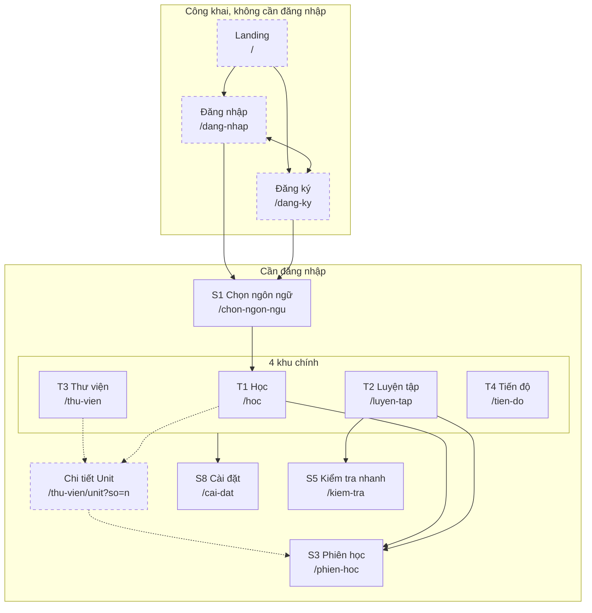
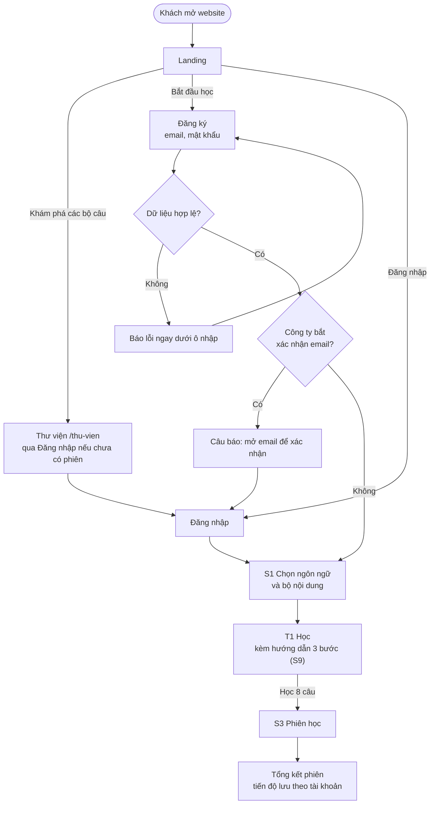
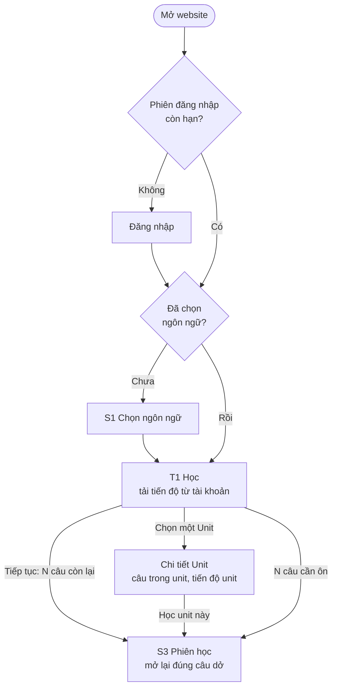
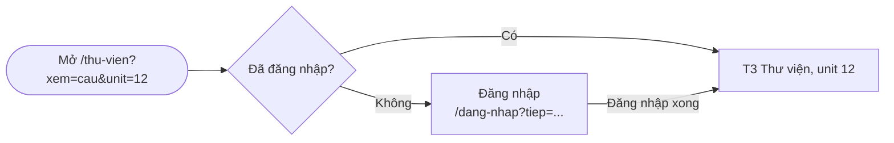

# Mô tả sản phẩm, sitemap và user flow

Trạng thái: viết ở Đợt 5 (20/10/2026, việc 11), cập nhật theo bản đã làm ở Đợt 6 (21/10/2026). Dựa trên QD-06, QD-07, QD-09 trong `docs/QUYET-DINH.md`.

Các màn mới đã có spec: Landing (`docs/spec/LP-landing`), Đăng nhập và Đăng ký (`docs/spec/AU-tai-khoan`), Chi tiết Unit (S10). Sơ đồ có gắn yêu cầu nằm ở `docs/new/navigation.md` mục 1; sơ đồ ở file này để đọc nhanh. Khi file này khác spec, spec thắng.

## 1. Mô tả sản phẩm

**Tên:** VITASR Đa ngôn ngữ.

**Mục tiêu:** giúp người Việt nói được câu giao tiếp thông dụng của một ngoại ngữ, bằng các phiên học ngắn mỗi ngày: học 8 câu trong 5 đến 10 phút, nghe câu, tự kiểm tra nhớ hay chưa, và ôn lại câu sắp quên đúng lúc.

**Đối tượng:**

| Nhóm | Nhu cầu | Bộ nội dung phù hợp |
|---|---|---|
| Người đi làm, sinh viên học tiếng Anh giao tiếp | Học lẻ tẻ trong ngày, cần biết mình tiến bộ | Global English (A1 đến C2, có tình huống và cách dùng) |
| Người chuẩn bị du lịch, du học, đi làm ở nước ngoài | Câu dùng ngay được ở sân bay, khách sạn, cửa hàng | English Fluency, hoặc ngôn ngữ của nước sẽ đến |
| Người học ngôn ngữ thứ hai, thứ ba | Một app cho nhiều ngôn ngữ, tiến độ tách riêng từng ngôn ngữ | English Fluency của 15 ngôn ngữ |

Giao diện tiếng Việt (có thêm tiếng Anh, QD-09), từ người mất gốc đến nâng cao.

**Chức năng chính** (đã có, chi tiết ở spec từng khu):

| Chức năng | Màn | Người học làm gì |
|---|---|---|
| Học theo lộ trình | T1 Học, S3 Phiên học | Mỗi phiên 8 câu: xem và nghe câu, tự đánh giá "Tôi nhớ" hay "Cần ôn lại", rồi làm trắc nghiệm |
| Ôn câu sắp quên | T1, T2 Luyện tập | Câu tự đến hạn ôn sau 1, 3, 7, 14, 30 ngày (DATA-07) |
| Học theo từ khóa | T2 | Gõ "đặt phòng", "sân bay"… để học đúng nhóm câu cần |
| Kiểm tra nhanh | S5 | 3 bước: nghe và chọn nghĩa, nghe theo cụm, sắp xếp câu |
| Thư viện câu | T3 | Tìm và lọc theo unit, chủ đề, trình độ, trạng thái |
| Tiến độ | T4 | Số câu đã học, câu cần ôn, biểu đồ 7 và 30 ngày |
| Giọng đọc, giao diện, mục tiêu tuần | S8 Cài đặt | Chọn giọng, tốc độ, sáng tối, số phiên mỗi tuần |

Thêm ở Đợt 5 và Đợt 6: thư viện dạng thẻ Unit kèm màn Chi tiết Unit (Đợt 5); trang giới thiệu cho khách, đăng ký và đăng nhập, tiến độ lưu theo tài khoản (học tiếp được trên máy khác), giao diện tiếng Anh (Đợt 6).

**Giá trị mang lại:**

1. Ngắn và đều: 8 câu một phiên, vừa một lần nghỉ giải lao.
2. Không học lại thứ đã nhớ: lịch ôn tự tính theo từng câu.
3. Nghe được mọi câu bằng giọng đọc của thiết bị, chỉnh được tốc độ.
4. Nhiều ngôn ngữ trong một chỗ, tiến độ riêng từng ngôn ngữ.

**Số liệu có thật** (Landing đọc từ `public/data/` lúc build, LP-03):

| Số liệu | Giá trị |
|---|---|
| Ngôn ngữ | 15 (Anh, Đức, Nhật, Lào, Hàn, Trung, Indonesia, Hindi, Tamil, Nga, Pháp, Tây Ban Nha, Thái, Bồ Đào Nha, Ý) |
| Câu mỗi ngôn ngữ, bộ English Fluency | 4.096 câu, 512 unit |
| Global English | 4.608 câu, 576 unit, 6 trình độ A1 đến C2 |

Landing chỉ dùng số liệu trong bảng này và ảnh chụp màn hình thật. Chưa có đối tác, lời nhận xét hay số người dùng thật thì không hiện (QD-07).

## 2. Sitemap

Nét đứt là màn có từ Đợt 5, 6.

Bảng route (đã đưa vào APP-04):

| Route | Màn | Ai vào được | Ghi chú |
|---|---|---|---|
| `/` | Landing | Mọi người | Đã đăng nhập: header hiện "Vào học" |
| `/dang-nhap` | Đăng nhập | Mọi người | Tham số `?tiep=` giữ route định mở trước khi bị chặn |
| `/dang-ky` | Đăng ký | Mọi người | |
| `/thu-vien/unit` | Chi tiết Unit | Đã đăng nhập | Tham số `?so=` số thứ tự unit |
| Các route khu học của APP-04 | S1, T1 đến T4, S3, S5, S8 | Đã đăng nhập | Chưa đăng nhập thì chuyển tới `/dang-nhap?tiep=…` |

Về dấu `#` (việc 10): từ Đợt 6 route là đường dẫn thật (QD-02), không còn dấu `#` trên URL; đường dẫn cũ `#/...` được chuyển sang đường dẫn mới (APP-04). Vẫn không dùng liên kết neo `href="#..."` (APP-13).

## 3. User flow

### 3.1 Khách lần đầu: từ Landing đến phiên học đầu tiên

### 3.2 Người đã có tài khoản quay lại

### 3.3 Mở thẳng một đường dẫn cần đăng nhập

Ví dụ người học lưu đường dẫn `/thu-vien?xem=cau&unit=12` rồi mở lại khi phiên đăng nhập đã hết hạn.

### 3.4 Khác nhau giữa khách và người đã đăng nhập

| | Khách | Người đã đăng nhập |
|---|---|---|
| Vào được | Landing, Đăng nhập, Đăng ký | Mọi màn học, Cài đặt |
| Mở `/` | Landing | Landing, header có "Vào học" |
| Mở route học | Chuyển tới Đăng nhập, xong thì quay lại đúng route | Vào thẳng |
| Tiến độ | Không có | Lưu theo tài khoản, có bản sao trên máy để học khi ngoại tuyến (QD-06) |
| Thanh điều hướng | Header công khai: logo trái; ngôn ngữ giao diện, sáng tối, Đăng nhập bên phải | Khung khu học: header và thanh bên (C5) |

## 4. Điểm cần thống nhất

Các điểm 1 đến 4 trùng với câu hỏi mở ở `ui-spec.md` mục 5. Cách đã làm ở Đợt 6 ghi kèm; công ty muốn khác thì sửa ở đợt sau.

1. Website mới thay thế hay chạy song song với trang học chính. Đã làm: giữ liên kết "Trang học chính" ở chân thanh bên và chân trang; đặt `NEXT_PUBLIC_HOST_URL` rỗng là bỏ (APP-12). Vẫn chờ công ty trả lời.
2. Có bắt xác nhận email khi đăng ký không. Đã làm cả hai nhánh: máy chủ bật xác nhận thì trang Đăng ký báo đã gửi thư (AU-02). Bật hay tắt do cấu hình project Supabase, chờ công ty.
3. Giới hạn số màn ở G-04. Chờ công ty.
4. Đối tác ở Landing. Chưa có thì không hiện (LP).
5. Quên mật khẩu: chưa làm (không có trong danh sách việc). Supabase hỗ trợ sẵn; đề xuất làm ở đợt sau cùng địa chỉ trang cho email đặt lại mật khẩu.
6. Đăng xuất: đặt ở thanh bên và S8 (AU-05, S8-08). Khác đề xuất ban đầu: không xóa dữ liệu trên máy khi đăng xuất; người khác đăng nhập trên cùng máy thì dữ liệu của người trước được cất riêng, người mới không thấy (AU-07). Như vậy người đăng nhập lại trên máy của mình không phải tải lại từ đầu.
7. Tiến độ trên máy từ trước khi có tài khoản: người đăng nhập đầu tiên trên máy nhận tiến độ đó và gửi lên tài khoản (AU-07, DATA-14), không hỏi, để người học cũ không mất tiến độ và luồng đăng nhập không thêm bước.
8. Khách học thử trước khi đăng ký: không làm.
